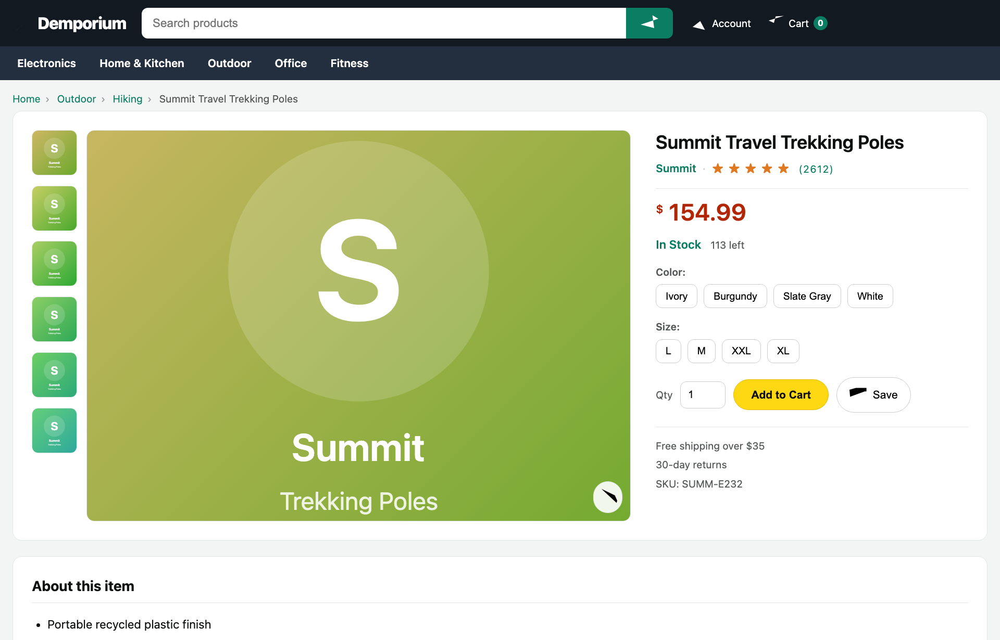
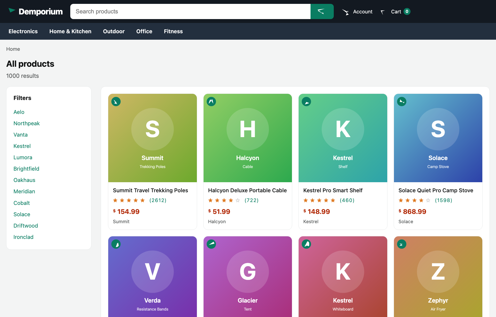

# frostwork-demo

A demo of [`frostwork`](https://github.com/shaneaevans/frostwork) as the one-pass, **DOM-free**
extraction backend inside **Scrapy + web-poet**. It has two parts:

1. **books.toscrape.com** — a real-site crawl whose page objects were scaffolded with the **Zyte
   web-scraping skills** (`/scrape-analyze-page` discovered the fields/selectors). Small pages.
2. **A generative storefront** ([`demo/site/`](demo/site/)) — a local server that emits heavy,
   Amazon/Walmart-class product pages (~555 KB, ~2,000 elements) carrying the **Zyte Common Product
   Schema**, crawled into `zyte_common_items.Product`. This is where Frostwork's one-pass engine
   actually pays off (see the benchmark below).
3. **The same storefront through a browser** — scrapy-playwright renders it, and the *same* schema is
   scanned off the rendered DOM instead of the wire bytes (`FrostBrowserPage`), reaching a field that
   only exists after JS runs.

Frostwork answers all of a page object's selectors in a single streaming scan — no lxml tree, no
DOM, **no fallback** (an unsupported selector returns an empty column, never a wrong value).

It lives as a **peer of the library** (`~/src/frostwork-demo` next to `~/src/frostwork`), is its
**own git repo**, and depends on the library through an **editable local path** — so you can
co-develop both, and the demo never reaches PyPI.

```
~/src/
├── frostwork/        # the library
└── frostwork-demo/   # this repo  ── depends on ../frostwork (editable)
```

## What it shows

How to put Frostwork behind web-poet with `frostwork.webpoet.FrostPage` (all page objects are in
[`demo/pages.py`](demo/pages.py) and [`demo/commerce.py`](demo/commerce.py)):

1. **Declarative selector fields** — `name = field("h1::text")` — compiled once; **every field is
   pulled in one streaming pass** over the page. Genuine web-poet page objects: injectable by
   scrapy-poet, `@handle_urls`-registrable, with async `to_item()`.
2. **`.map(...)` / `.re_first(...)`** — a transform chains straight onto a field
   (`field(".price::text").map(parse_amount)`); it runs in Python on the tiny extracted value, never
   in the scan. Fields that need the response or other fields (`urljoin`, `productId`) are plain
   `@web_poet.field` methods.
3. **One schema, either response** — the field bundle lives on a `FrostFields` subclass with no
   response contract, so `ProductPage(ProductFields, FrostPage)` and
   `ProductBrowserPage(ProductFields, FrostBrowserPage)` share it verbatim. See
   [the browser section](#third-demo-through-a-browser-demobrowserpy).
4. **`Many` / `One` for nested collections** — the whole `zyte_common_items.Product`, including the
   nested `Brand`/`Image`/`AggregateRating`/`Breadcrumb`/`AdditionalProperty` types, comes out of
   **one scan**. `Many(".thumb-list .thumb-item", item=Image, url=field("img::attr(src)"))` extracts
   one sub-object per container (each sub-field scoped to it), built into the matching zyte type — no
   DOM, no per-container re-parse. Rows are byte-identical to Parsel's per-container `.css()`.

It also shows Frostwork's **no-fallback** contract directly (`demo/standalone.py`, section 4): an
unsupported selector like `:contains()` yields `[]`, rather than raising or silently routing to
another engine — so a value is either lxml-identical or absent, never wrong.

## The code

The demo is small and meant to be read — the page objects and spiders are the point.

| File | What's in it |
|---|---|
| [`demo/pages.py`](demo/pages.py) | books.toscrape page objects: `BookPage` (detail) and `NavigationPage` (listing), on `FrostPage` with `.map`/`.re_first` and parallel-column cards. |
| [`demo/spiders/books.py`](demo/spiders/books.py) | The Scrapy spider crawling books.toscrape — scrapy-poet injects the page objects into the callbacks. |
| [`demo/commerce.py`](demo/commerce.py) | Storefront schema: the whole `zyte_common_items.Product` (nested types included) on `ProductFields`, bound to `HttpResponse` by `ProductPage`. |
| [`demo/spiders/commerce.py`](demo/spiders/commerce.py) | The spider crawling the local storefront. |
| [`demo/browser.py`](demo/browser.py) | The browser path: the same `ProductFields` on `FrostBrowserPage`, plus the `BrowserResponse` provider scrapy-poet doesn't ship. |
| [`demo/spiders/commerce_browser.py`](demo/spiders/commerce_browser.py) | The same crawl through scrapy-playwright (Chromium). |
| [`demo/prices.py`](demo/prices.py) | Shared price/currency parsing: `price-parser` for the amount, an explicit symbol→ISO map for the currency code. |
| [`demo/standalone.py`](demo/standalone.py) | Runs the page objects **without Scrapy**, against saved fixtures — the quickest read of the integration. |
| [`demo/bench.py`](demo/bench.py) | The one-pass-vs-Parsel benchmark. |
| [`demo/site/`](demo/site/) | The generative storefront server (`catalog.py`, `render.py`, `server.py`). |
| [`tests/`](tests/) | Fixture-based tests exercising the real async `to_item()` path, including both response contracts. |

Both spiders are deliberately tiny — the same shape you'd write without Frostwork. The page object is
the only thing that changed; the spider never knows which engine runs underneath.

## Setup

### Prerequisites

- **[uv](https://docs.astral.sh/uv/)** — manages the Python (3.13+) environment and dependencies.
- **A Rust toolchain** — the demo builds Frostwork from source (it's a Rust extension built with
  maturin). [rustup](https://rustup.rs/) is the easiest way to get one.
- **A checkout of [frostwork](https://github.com/shaneaevans/frostwork)** — the library the demo
  depends on. The setup script finds it for you (see below).

### Install

The easiest layout is to clone frostwork as a sibling of this repo, then run `./setup.sh`:

```bash
git clone https://github.com/shaneaevans/frostwork.git      ~/src/frostwork
git clone https://github.com/shaneaevans/frostwork-demo.git ~/src/frostwork-demo
cd ~/src/frostwork-demo
./setup.sh        # links the library into vendor/, then runs `uv sync`
```

`setup.sh` finds the library, symlinks it to `vendor/frostwork` (gitignored), and installs
everything into `.venv`. It searches, in order: `$FROSTWORK_DIR`, `../frostwork`, and
`~/src/frostwork`. If your checkout is somewhere else, point at it once:

```bash
FROSTWORK_DIR=/path/to/frostwork ./setup.sh
```

The committed dependency path is the fixed `vendor/frostwork` symlink, so nobody's machine-specific
path lands in `pyproject.toml` or `uv.lock`. After the first run, re-installs are just `uv sync` (or
`./setup.sh` again — it's idempotent).

## Run

These are ordered easiest-first — start at the top for the quickest look, no network or server
needed:

```bash
# No Scrapy — the quickest look (both bridges + the no-fallback demo), on saved fixtures:
uv run python -m demo.standalone

# Fixture tests (no network), exercising the real async to_item() path:
uv run pytest

# The real stack — Scrapy + scrapy-poet crawling books.toscrape.com over plain HTTP.
# Cap a demo run so it doesn't fetch all 1000 books:
uv run scrapy crawl books -s CLOSESPIDER_ITEMCOUNT=40 -O out/books.json
cat out/books.json
```

The crawl needs **no Zyte API key** — books.toscrape.com is a static sandbox, so scrapy-poet builds
the web-poet `HttpResponse` from the ordinary Scrapy download. Frostwork is the extraction backend
inside the page objects, invisible to Scrapy itself. Drop the `CLOSESPIDER_ITEMCOUNT` to crawl the
whole catalogue.

The **developer cache** (Scrapy's on-disk HTTP cache) is enabled in
[`demo/settings.py`](demo/settings.py), so the first run fetches the pages and every re-run replays
them from `.scrapy/httpcache` (gitignored) — fast iteration on the page objects, no repeat traffic to
the sandbox. Delete that directory to force a fresh fetch.

## Second demo: a generative storefront ([`demo/site/`](demo/site/))




<p align="center"><em>A product detail page (the ~555 KB page the demo extracts) and an "all products"
listing — both rendered live by <a href="demo/site/"><code>demo/site/</code></a>, with no stored HTML
and no binary assets. Run <code>uv run python -m demo.site.server</code>, then open
<a href="http://127.0.0.1:8000/p/1">/p/1</a> or <a href="http://127.0.0.1:8000/c">/c</a>.</em></p>

The books pages are tiny, so the extraction engine barely matters. To show Frostwork where it counts
— a big page with a wide schema — the repo ships a **local, generative e-commerce site**: a
dependency-free server that builds a fresh product page on every request, with no stored HTML and no
network.

Each product follows the **Zyte Common Product Schema** (`zyte_common_items.Product`: `name`, `brand`,
`price`/`regularPrice`/`currency`, `availability`, `sku`/`mpn`, `breadcrumbs`, `mainImage`/`images`,
`aggregateRating`, `additionalProperties`, `features`, …) laid into a heavy Amazon/Walmart-class page
— mega-nav, gallery, buy-box, spec table, reviews, "customers also bought" grids, a footer link-farm,
inline SVG icons, JSON-LD, and a big `__APP_STATE__` JSON island. The page *shape* is calibrated to
Zyte's real-world corpus; page size targets the product-page slice (~555 KB median):

| Metric | Zyte real-world target | This site (generated) |
|---|---|---|
| Page size (median) | ~555 KB (product pages) | ~558 KB |
| Elements / page | ~1,800–2,400 | ~2,000 |
| Inline SVG | ~11% of elements | ~10% |
| Has JSON-LD | 79% | yes (Product + BreadcrumbList) |

Start the server first and leave it running — both the crawl and the benchmark connect to it:

```bash
# terminal 1 — start the storefront and leave it running (serves on http://127.0.0.1:8000):
uv run python -m demo.site.server

# terminal 2 — crawl it, then benchmark the extraction engine against it:
uv run scrapy crawl commerce -s CLOSESPIDER_ITEMCOUNT=50 -O out/products.json
uv run python -m demo.bench                                    # one-pass vs Parsel
```

The same crawl runs through a real browser too — see [the browser
section](#third-demo-through-a-browser-demobrowserpy).

[`demo/commerce.py`](demo/commerce.py) extracts the **whole `Product` — scalars plus five nested
types (`Brand`, `Image`, `AggregateRating`, `Breadcrumb`, `AdditionalProperty`) — in one streaming
pass**. The schema lives on `ProductFields`, a `FrostFields` subclass with **no response contract**;
`ProductPage` binds it to the bytes off the wire, and the browser path below binds the same fields to
a rendered DOM.

### The payoff ([`demo/bench.py`](demo/bench.py), ~555 KB pages)

The numbers below are illustrative — they vary with your machine, so run `demo/bench.py` yourself for
your own figures. The ratio is what matters, and it is specific to *this* workload (one wide `Product`
schema over a ~555 KB page); Frostwork's own
[docs/BENCHMARKS.md](https://github.com/shaneaevans/frostwork/blob/main/docs/BENCHMARKS.md) is the
canonical set of figures across page shapes and field counts:

| Extracting the `Product` schema | Parsel ms/page | Frostwork ms/page | vs Parsel |
|---|---|---|---|
| The 11 flat `field(...)` selectors | ~12.7 | ~1.0 | ~13× |
| **The whole item** (+ 6 `Many`/`One`, 9 sub-selectors) | ~20.5 | ~1.1 | **~18×** |

(Measured on an M-series Mac, Python 3.13, lxml 6.1, Frostwork built in release mode.)

Frostwork and Parsel return **byte-identical columns** — every flat field *and* every row of every
nested collection (parity asserted in `bench.py` and `tests/test_commerce.py`). The two rows are the
interesting part: going from 11 selectors to the whole item costs Frostwork **+0.1 ms** and Parsel
**+8 ms**, because Parsel has to re-run each sub-selector against each matched container while
Frostwork scopes them inside the pass it was already making. Adding fields or nesting stays nearly
free; Parsel pays the full lxml parse up front no matter how little you select. The gap is widest
exactly here — a big page with a wide schema — and narrows on tiny pages where the parse is cheap
either way.

> **Build Frostwork in release mode.** `uv sync` builds the extension release by default; if you ever
> `maturin develop` it into the venv by hand, add `--release`, or the Rust core runs ~10× slow and
> `bench.py` will warn you.

## Third demo: through a browser ([`demo/browser.py`](demo/browser.py))

Everything above scans the bytes the server sent. Frostwork's other response contract scans what a
*browser* made of them — and the point of this section is that **nothing else changes**: same
`ProductFields`, same one streaming pass, same columns.

| | Base class | Scans |
|---|---|---|
| Direct (default) | `FrostPage` | `response.body` — an `HttpResponse`, the bytes off the wire |
| Browser | `FrostBrowserPage` | `response.html` — a `BrowserResponse`, the DOM after JS ran |

The storefront gives the browser something to do: the buy box's `#delivery` block is served **empty**
and filled client-side from the `__APP_STATE__` island ([`demo/site/render.py`](demo/site/render.py),
`_HYDRATE_JS`). So `delivery_window` / `delivery_cost` are `None` on the direct path and carry values
on the browser path — while every other field stays byte-identical, which
[`tests/test_browser.py`](tests/test_browser.py) asserts field for field.

```bash
uv sync --extra browser && uv run playwright install chromium   # once

uv run python -m demo.site.server                               # terminal 1
uv run scrapy crawl commerce_browser -s CLOSESPIDER_ITEMCOUNT=10 -O out/browser.json
```

```json
{ "name": "Hearthstone Adjustable Deluxe Vest", "price": "40.99", "sku": "…",
  "delivery_window": "Arrives in 5–7 days", "delivery_cost": "Free delivery" }
```

One piece is the demo's own, not the library's: **plain scrapy-poet ships no provider for
`BrowserResponse`** (it can't know a response came from a browser — that's the download handler's
business), so [`demo/browser.py`](demo/browser.py) supplies a ~10-line `BrowserResponseProvider` that
wraps the rendered `response.text`. Registered via `SCRAPY_POET_PROVIDERS`; because it needs the real
download, the browser spider's callbacks take a `scrapy.http.Response` rather than a `DummyResponse`.

On the **Zyte API** stack you write none of that: `scrapy-zyte-api[provider]`'s `ZyteApiProvider`
already provides `BrowserResponse`, `BrowserHtml` and `AnyResponse`, so a `FrostBrowserPage` is injected
with no wiring. This demo needs the provider only because it deliberately runs without an API key.

Without the `browser` extra installed, `uv run pytest` skips the one test that needs Chromium and runs
the rest — the response contract itself is checked offline, by applying the site's own hydration
script in Python.

## How the local link works

`pyproject.toml` points the dependency at a fixed in-repo path, editable:

```toml
[tool.uv.sources]
frostwork = { path = "vendor/frostwork", editable = true }
```

`vendor/frostwork` is a gitignored symlink to your actual checkout, created by `./setup.sh` (see
Setup). The committed path never changes, so it stays the same across machines — only the symlink
differs locally.

* **Python edits** in the library (`frostwork/python/…`, e.g. the web-poet bridge) are picked up
  immediately (editable install).
* **Rust edits** need a rebuild of the native extension:

  ```bash
  uv sync --reinstall-package frostwork
  ```

If you move the library, re-run `./setup.sh` (or repoint the `vendor/frostwork` symlink) — no need to
touch `pyproject.toml`.
